# 移植篇(一)：Windows 11 从头编译 PYNQ v3.1.2 镜像（Docker 方案）

## 0. 写在前面

**读者画像**：这是一篇写给像我一样的在校本科生和实验室萌新的"从头编译 PYNQ v3.1.2 镜像"的教程。由于从Windows宿主机上的环境配置开始讲起，所以会略显絮叨，有经验的读者仅作参考。
本教程适合初次接触 Xilinx Zynq FPGA 板卡，无任何硬件开发与调试经验的在校学生（因为后续一些问题的解决方案需要依托学校和实验室的资源），你需要的基础只有：

- 会使用 powershell 等命令行工具
- 能使用简单的 git 命令，有一个自己的 GitHub 账号
- 有磁盘管理意识
- 有查阅英文文档和通过询问AI处理报错的耐心

**开始之前**：你需要一块百度 FZ3B 开发板(FZ3A也可，两者的芯片均为ACU3EG，最大不同仅在于板载内存，见 [EdgeBoard FZ3A/B 计算卡官方文档](https://ai.baidu.com/ai-doc/HWCE/Qkda68drw#edgeboard_fz3ab%E8%AE%A1%E7%AE%97%E5%8D%A1))，由于百度官方生态(EdgeBoard SDK)已停滞多年，硬件为 2019 年产品，社区通过 PYNQ 移植让它以通用开发板的身份继续发挥作用。目前已无法从百度或ALINX官网找到销售渠道，想新购的读者可以去二手市场寻找库存(价格应为千元以内，远低于 ALINX ACU3EG 板卡)。

**参考资料**：[zhutmost 博客](https://zhutmost.com/post/pynq-compile-2); [zhutmost github仓库](https://github.com/zhutmost/edgeboard); [Xilinx PYNQ github仓库](https://github.com/Xilinx/PYNQ); [PYNQ 文档](https://pynq.readthedocs.io/en/v3.1/)

**编译环境一览表**：

| 组件 | 版本 | 安装位置 |
|---|---|---|
| WSL2 | Ubuntu 24.04, 可用新版 | 初始位置为C盘，后续可迁移 |
| PYNQ 源码 | **v3.1.2**（tag） | WSL2 ext4 |
| Vivado + Vitis | **2024.1，Linux 版** | WSL2 ext4 |
| PetaLinux | **2024.1** | WSL2 ext4 |
| 编译容器 | ubuntu:22.04（v3.1.2 官方 Dockerfile 锁定） | 通过 docker 拉取和构建 |
| 镜像内系统 | Ubuntu 22.04（jammy，`UBUNTU_RELEASE` 指定） | 编译产物 |
| Docker | Docker Desktop | Windows D盘，需要先安装 WSL2 |

**总成本**：一块 FZ3B 板卡；一张 16GB(至少，因为镜像大小就有约 10 GB) 的 TF 卡及读卡器；一条网线；D 盘空闲 ≥ 250GB（保守估计）；编译 1~2 小时 + 大量排坑时间，建议留出两个下午。

## 1. 安装 WSL2 Ubuntu

**step1**：在 PowerShell（管理员）中执行（推荐安装到D盘）：

```powershell
wsl --install
```

或安装指定版本：

```powershell
wsl --install -d Ubuntu-24.04
```

指定安装路径到D盘：

```powershell
wsl --install -d Ubuntu-24.04 --location D:\WSL2\Ubuntu-24.04 
```

重启后进入 Ubuntu 首次初始化：新建用户名和密码，这个密码只用于提供 `sudo` 权限

详情见：[MicroSoft 官方教程：设置 WSL 开发环境](https://learn.microsoft.com/zh-cn/windows/wsl/setup/environment);
[社区教程1](https://blog.csdn.net/weixin_50563385/article/details/159085131)

## 2.安装 Docker Desktop

详情见：[Install Docker Desktop on Windows](https://docs.docker.com/desktop/setup/install/windows-install/);
[社区教程1](https://www.cnblogs.com/zhenghang4121/p/22439436)

并将Docker设为 WSL 可用：
[Docker 官方 WSL 教程](https://docs.docker.com/desktop/features/wsl/)

## 3.注册 AMD 账号

到 [AMD 官网开发者入口](https://www.amd.com/zh-cn/registration/create-account.html)注册账号。注册过程有以下几点需要注意([参考资料](https://ask.csdn.net/questions/9752917))：

### 3.1 下载管制

AMD 的开发工具受美国出口管制（EAR）约束，被列入实体清单的高校学生请勿使用学校邮箱，个人邮箱推荐 `@gmail`，`@163` 不一定可以

- **注意**：本教程不提供任何绕过管制的手段，但你或许可以寻找你的实验室Mentor寻求帮助。许多高校 FPGA 实验室提供 Vivado + Vitis 的安装包，配合学校已有的 license 可以离线安装

### 3.2 换浏览器+无痕模式

AMD 注册页对国产浏览器（360/QQ 浏览器的兼容模式）和带插件的浏览器经常报错——用 Edge

### 3.3 使用学校邮箱注册账号

对于未被管制的高校学生，推荐使用 `.edu.cn` 学校邮箱注册，因为 QQ/163 等免费邮箱有时被 AMD 风控拦截。我使用个人 `@163` 邮箱被直接拦截，换我的学校邮箱 `@mail.scut.edu.cn` 提交表单失败，后续申诉一次成功了。

**若提交表单失败**：发邮件申诉，主送 `account.help@amd.com`，抄送 `websupport@xilinx.com`（AMD 官方社区对账号注册/验证类问题指定的联系方式），附件带上**学生证照片**。邮件模板如下：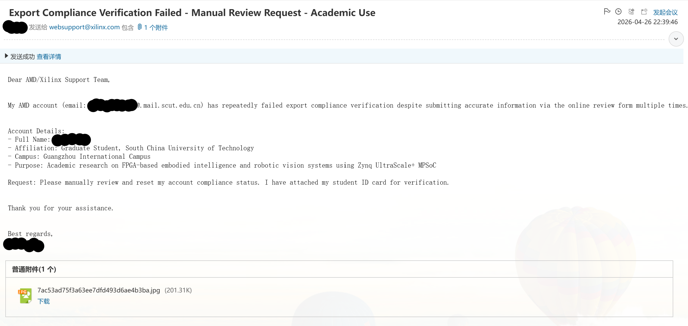

```yaml
主题：Export Compliance Verification Failed - Manual Review Request - Academic Use

Dear AMD/Xilinx Support Team,

My AMD account (email: <注册邮箱>) has repeatedly failed export compliance
verification despite submitting accurate information via the online review
form multiple times.

Account Details:
- Full Name:    <姓名拼音，与账号注册信息一致>
- Affiliation:  Graduate Student, <学校英文名>
- Purpose:      Academic research on FPGA-based <研究内容> using
                Zynq UltraScale+ MPSoC

Request: Please manually review and reset my account compliance status.
I have attached my student ID card for verification.

Thank you for your assistance.

Best regards,
<姓名拼音>
```

同类问题参考：[官方账号创建指引（Article 34573）](https://adaptivesupport.amd.com/s/article/34573)、[出口合规验证说明（Article 44043）](https://adaptivesupport.amd.com/s/article/44043)、[CSDN 实测——合规性不通过导致无法下载的处理过程](https://blog.csdn.net/weixin_59962778/article/details/128019483)。

### 3.4 注意网络环境

如果挂着代理/VPN，先关掉再试（代理 IP 段常被注册系统拒绝） 

进入[vivado 2024.1 下载页面](https://www.amd.com/zh-cn/support/downloads/adaptive-socs-and-fpgas/development-tools/2024-1.html)后，若校园网稳定，推荐 Web Installer，Linux 版

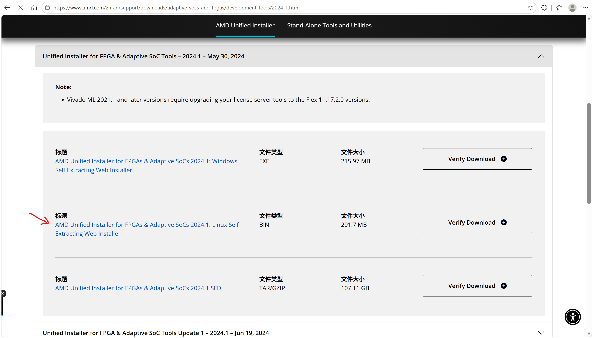

### Web Installer 还是完整安装包？

| 形态 | 优点 | 缺点 |
|---|---|---|
| Web Installer（200多 MB） | 运行时在线拉组件安装 | 安装时长网络依赖大 |
| 完整统一安装包（tar，一百多 GB） | 一次下完，断点可控 | 单文件巨大，需额外空间解压 |

## 4. 安装 Vivado + Vitis 2024.1（Linux 版，进 WSL2）

**下载**：AMD 官网 → Unified Installer，选 **Linux 版**（`.bin` 或完整 tar 包），
文件名形如 `FPGAs_AdaptiveSoCs_Unified_SDI_2024.1_*.bin`。下载到 Windows 后，从 WSL2 内拷进 ext4：

```bash
mkdir -p ~/downloads && cp /mnt/c/Users/<your-username>/Downloads/FPGAs_AdaptiveSoCs_Unified_2024.1_0522_2023_Lin64.bin ~/downloads/
# 记得将 c/Users/<your-username>/Downloads 替换成本机 Edge 默认下载地址，之后遇到浏览器下载的文件也是如此
```

**安装**：

```bash
chmod +x ~/downloads/FPGAs_AdaptiveSoCs_Unified_2024.1_0522_2023_Lin64.bin
~/downloads/FPGAs_AdaptiveSoCs_Unified_2024.1_0522_2023_Lin64.bin                 # 自动启动 WSLg 图形安装向导
```

图形向导关键步骤：

**step1.** 弹出 `A Newer Verion Is Available` 框时，选 `Continue`；
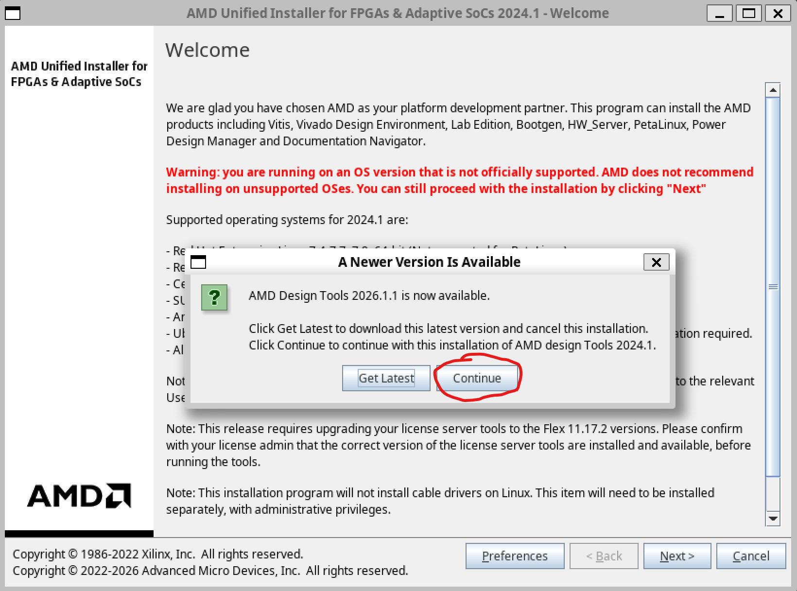
**step2.** 选 Download and Install Now，账号和密码填你表单上上交的那个；
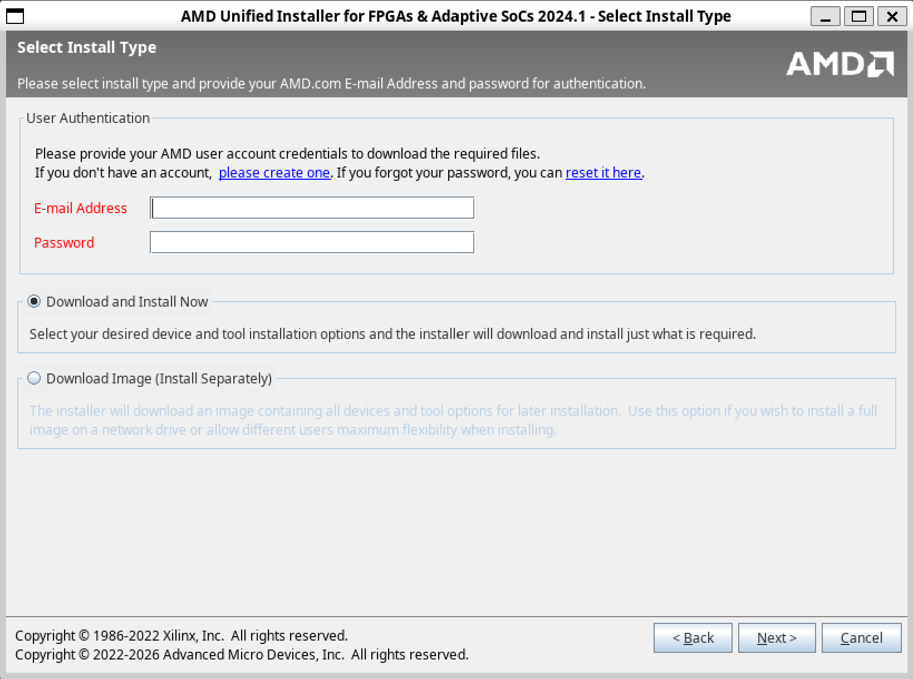
**step3.** Install Type：**Vitis**（统一安装器，Vivado 会一并装入）；
勾选器件族时**只留 Zynq UltraScale+ MPSoC**（ZU3EG 属于此族）即可完成教程，精简后还需留出 110 GB 空闲，实际压缩包载荷约 23 GB；
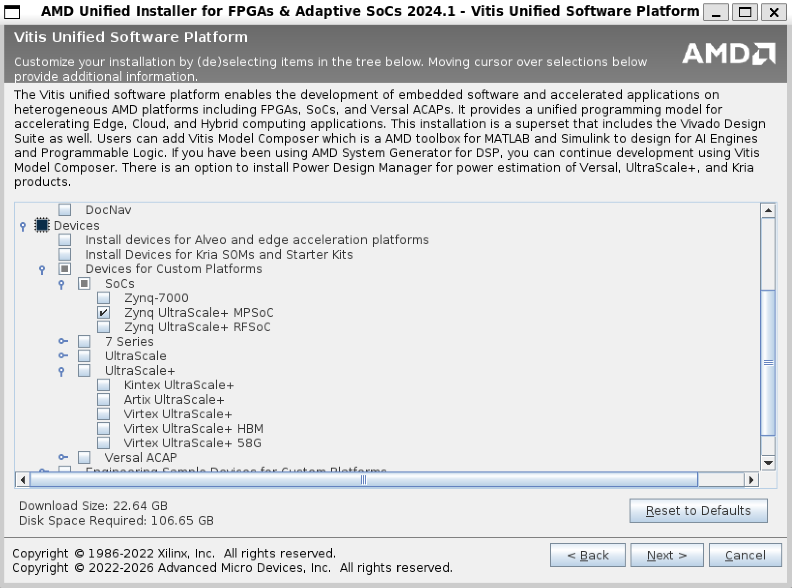
安装路径 `/home/<your-username>/tools/Xilinx`，最终磁盘占用可以查看 `Final Disk Usage`, 应该只有 50 多 GB；
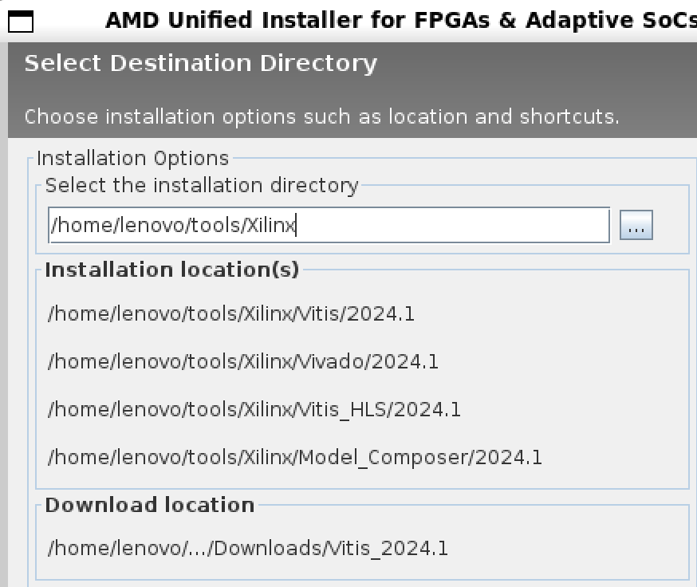
**step4.** 接下来就是等待和休息了，时间取决于你的校园网质量；另外不要长时间离开，安装过程可能需要你参与授权一些

**许可证落地**：当前教程安装为免费版，下完即可用。实验室如果有 Enterprise license，询问你的 Mentor 获取使用方法。

**验证**：

```bash
source ~/tools/Xilinx/Vivado/2024.1/settings64.sh
vivado -version                                         # 注意 vivado 的版本验证为单横杠
source ~/tools/Xilinx/Vitis/2024.1/settings64.sh
vitis --version                                     
```

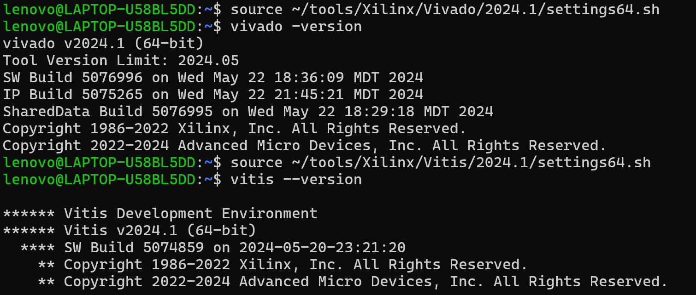

## 5. 安装 PetaLinux 2024.1（进 WSL2）

**OS 支持口径**：PetaLinux 2024.1 官方宿主列表是 Ubuntu
20.04.4/22.04[UG973](https://docs.amd.com/r/2024.1-English/ug973-vivado-release-notes-install-license/Supported-Operating-Systems)，没有 24.04——但这个约束只作用于二进制
运行时（在容器里），安装器在 WSL2 上只负责解包。作者 @zhutmost 在 Ubuntu 25.04 上安装
成功[参考资料](https://zhutmost.com/post/pynq-compile-2)，佐证安装器不校验宿主版本，放心装。

**安装**：


**先将 /bin/sh 指向 bash**

```bash
sudo ln -sf bash /bin/sh
ls -l /bin/sh
```

```bash
cp /mnt/c/Users/<your-username>/Downloads/petalinux-v2024.1-05202009-installer.run ~/downloads/
mkdir -p ~/petalinux/2024.1
chmod +x ~/downloads/petalinux-v2024.1-05202009-installer.run
~/downloads/petalinux-v2024.1-05202009-installer.run -d ~/petalinux/2024.1
```

一般新装的 WSL Ubuntu 24.04 都会遇到的问题，详情见[PetaLinux 2024.1安装笔记](https://developer.aliyun.com/article/1592251)：

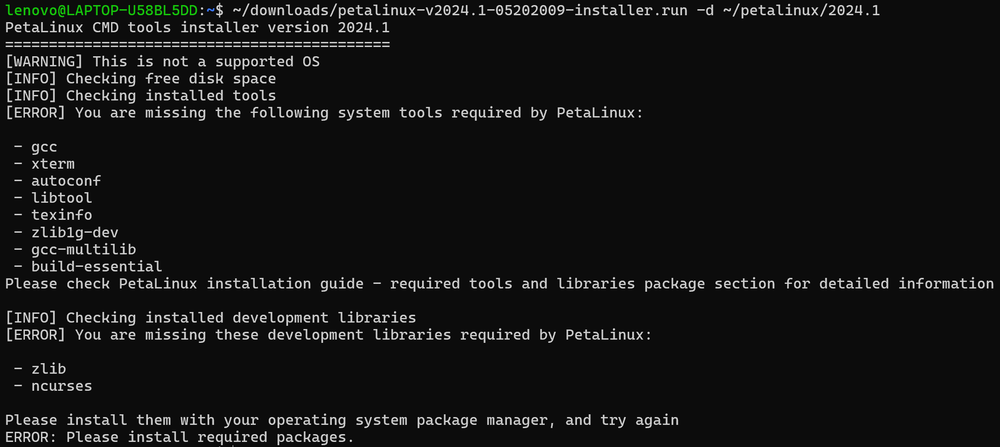

补装

```bash
sudo apt update
sudo apt-get install gcc xterm autoconf libtool texinfo zlib1g-dev gcc-multilib build-essential zlib1g libncurses5-dev
```

重新执行

```bash
~/downloads/petalinux-v2024.1-05202009-installer.run -d ~/petalinux/2024.1
```

报 [WARNING] No tftp server found 不用管，看完条款按 `q` 退出，按 `y` 同意

**验证**：

```bash
source ~/petalinux/2024.1/settings.sh
echo $PETALINUX_VER    # 输出版本 2024.1
```

## 6. 准备 PYNQ 源码、预编译组件与 FZ3B 板卡文件

### 6.1 解决 WSL 下通过 ssh 克隆仓库的问题

**step1**：首先你需要将 Windows 上的网络接口“镜像”到 Linux，详情参考：
[MicroSoft 官方教程](https://learn.microsoft.com/zh-cn/windows/wsl/networking#mirrored-mode-networking)

**step2**：其次在 WSL 中生成 ssh key，详情见以下资料：
[社区教程1](https://juejin.cn/post/7656739222133850152)
[github 官方文档1](https://docs.github.com/en/authentication/connecting-to-github-with-ssh/generating-a-new-ssh-key-and-adding-it-to-the-ssh-agent)
[github 官方文档2](https://docs.github.com/en/authentication/connecting-to-github-with-ssh/adding-a-new-ssh-key-to-your-github-account)

**排查文档**：
[github 排查 ssh 故障](https://docs.github.com/en/authentication/troubleshooting-ssh/using-ssh-over-the-https-port)

### 6.2 克隆 PYNQ v3.1.2 源码并编译

```bash
git config --global core.autocrlf false   # 保险：禁止行尾自动转换
git clone --depth 1 --branch v3.1.2 --recursive https://github.com/Xilinx/PYNQ.git ~/pynq
# 与 prebuilt 制品（sdist 3.1.2）同版本的发布 tag，子模块需全量
cd ~/pynq && git rev-parse HEAD
# 应输出 3c77124d86bab65ac7bb6beb0aa66e13c83508f2
```

**FZ3B 板卡文件接入**（由 [@changhai0109](https://github.com/changhai0109) 贡献，见第 13 节致谢）：

```bash
git clone https://github.com/zhutmost/edgeboard.git ~/edgeboard
```

注意，这里直接沿用 

看懂三件套（编译时才知道每步在干嘛）：

1. `edgeboard-fz3b.spec`（来源：zhutmost/edgeboard，MIT）：

   ```makefile
   ARCH_edgeboard-fz3b := aarch64          # ZU+ 是 64 位 ARM
   BSP_edgeboard-fz3b :=                   # 留空：由 base.xsa 自动生成 BSP
   BITSTREAM_edgeboard-fz3b := base/base.bit   # 开机加载的 overlay
   FPGA_MANAGER_edgeboard-fz3b := 1        # PL 重配置由内核接管
   STAGE4_PACKAGES_edgeboard-fz3b := xrt pynq boot_leds ethernet
   ```

2. `petalinux_bsp/`：`hardware_project/base.xsa` 交给流程自动生成 BSP；
   `meta-user/.../system-user.dtsi` 只做一件事——修 TF 卡控制器（`sdhci1`）的
   频率与 1.8V 信号问题；
3. `packages/boot_leds/`：开机自动加载 base overlay 并闪灯的小包（`pre.sh` 把
   `boot.py` 塞进镜像 `/boot/`）。
**预编译组件**（sdbuild 从 v3.0 起要求预置，避免每次重建 Ubuntu rootfs）：从[PYNQ boards 页](https://www.pynq.io/boards.html) 下载 3.1 线的两个板卡无关构件，实测页面上是 [pynq-3.1.2.tar.gz](https://download.amd.com/opendownload/pynq/pynq-3.1.2.tar.gz)（PYNQ 包源码分发，与检出的源码同为 3.1.2 版本，全链一致）和 [jammy.aarch64.3.1.0.tar.gz](https://download.amd.com/opendownload/pynq/jammy.aarch64.3.1.0.tar.gz)（Ubuntu 22.04 rootfs 底盘，标签 3.1.0 无碍，PYNQ 包版本由 sdist 决定）。下载时用原名，拷入 `prebuilt/` 时**改成 sdbuild认的固定文件名**：

```bash
cp /mnt/c/Users/<your-username>/Downloads/jammy.aarch64.3.1.0.tar.gz ~/pynq/sdbuild/prebuilt/pynq_rootfs.aarch64.tar.gz
cp /mnt/c/Users/<your-username>/Downloads/pynq-3.1.2.tar.gz ~/pynq/sdbuild/prebuilt/pynq_sdist.tar.gz
```

### 6.3 修改设备树：sdhci1 修复与 bootargs 指向

**修改 bootargs 的真正入口 `pynq_bootargs.dtsi`**——它属于 PYNQ 自带的 meta-pynq 层，对 `chosen/bootargs` 的定义会覆盖板卡文件的 system-user.dtsi（实测：dtb 最终采用了它的 `root=/dev/mmcblk0p2`）：

```bash
sed -i 's|root=/dev/mmcblk0p2|root=/dev/mmcblk1p2|' \
  ~/pynq/sdbuild/boot/meta-pynq/recipes-bsp/device-tree/files/pynq_bootargs.dtsi
```

**为什么要改**：FZ3B 是 **eMMC + TF 卡双存储**板。启动日志的分区清单显示，设备枚举结果为 eMMC = `mmcblk0`（7.28GB，内含出厂分区）、TF 卡 = `mmcblk1`（8.88GB rootfs）。而 PetaLinux 模板生成的默认 bootargs 是 `root=/dev/mmcblk0p2`——指向的是 **eMMC 里的出厂分区**，它不是 PYNQ 的 ext4，首次启动必然：

```bash
Kernel panic - not syncing: VFS: Unable to mount root fs on unknown-block(179,10)
No filesystem could mount root, tried: ext4
```

上面的覆盖把 root 显式指到 TF 卡的 rootfs 分区。控制台 `ttyPS0`（ff010000）就是
USB-UART 接的那颗 UART——官方手册的 USB_UART 接口表（PS_UART1，MIO24/25）与之一致，
构建完成后串口全程可见内核日志。跳过这一步的后果与补救见第 10 节坑 7。

然后迁移 FZ3B 板卡文件：

```bash
cp -r ~/edgeboard/pynq/edgeboard-fz3b ~/pynq/boards/
```

## 7. 构建 Docker 镜像并启动编译

先在 Windows 双击运行 Docker Desktop，回到 **WSL2 终端** 运行：

```bash
docker version
```

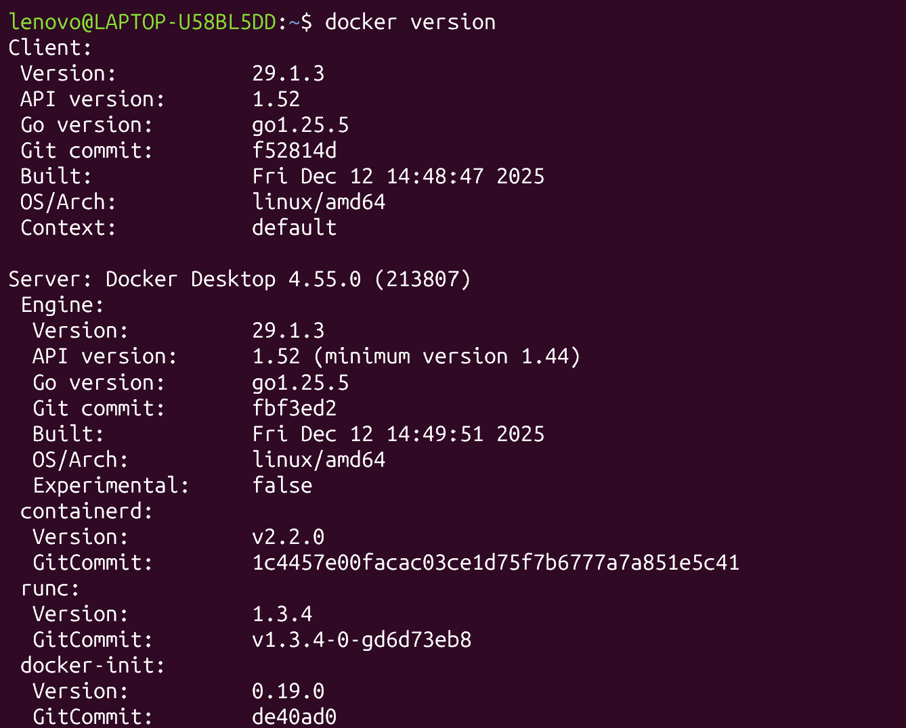
挂载路径一律写 WSL2 内部路径，不要写 `\\wsl$` UNC。

**构建容器镜像**（三个 build-arg 让容器内产物归属你，避免 root 文件污染仓库）：

```bash
cd ~/pynq/sdbuild
docker build \
  --build-arg USERNAME=$(whoami) \
  --build-arg USER_UID=$(id -u) \
  --build-arg USER_GID=$(id -g) \
  -t pynqdock:latest .
```

遇到因国内网络拉取失败的报错，先在 Docker 配置一份代理脚本，详情见：
[dockerproxy 国内镜像站解决方案](https://dockerproxy.net/docs)；
[Docker 官方手册](https://docker.it-docs.cn/manuals/engine_daemon_proxy)

但是对于解决了 Github 或是 Gmail 邮箱账号注册的读者，想必我不用说也有更好的解决方案

若没有“更好的解决方案”，我通过实践发现：
**国内网络补丁：预下载 QEMU 源码**（`download.qemu.org` 在国内常被掐断，首次
`docker build` 会在第 5 步 wget 失败；思路是把"下载"换成"喂包"）：

1. 在 Windows 浏览器下载
   [`https://download.qemu.org/qemu-5.2.0.tar.bz2`](https://download.qemu.org/qemu-5.2.0.tar.bz2)
   （约 65MB，浏览器可断点续传；TUNA/USTC/NJU 均无 qemu 镜像，别绕路）；
2. 拷进 build context，并给 Dockerfile 打两行补丁（插入 COPY、删去 wget 行）：

   ```bash
   cp /mnt/c/Users/<your-username>/Downloads/qemu-5.2.0.tar.bz2 ~/pynq/sdbuild/
   ```

   ```dockerfile
   # Build and install QEMU
   COPY qemu-5.2.0.tar.bz2 /opt/qemu-src/
   RUN cd /opt/qemu-src \
    && qemuver=5.2.0 \
    && tar -xf qemu-$qemuver.tar.bz2 \
    && cd qemu-$qemuver \
    && ./configure --target-list=arm-linux-user,aarch64-linux-user --prefix=/opt/qemu --static \
    && make -j$(nproc) && make install \
    && cd /opt/qemu/bin \
    && rm -f qemu-arm-static qemu-aarch64-static \
    && ln -s qemu-arm qemu-arm-static \
    && ln -s qemu-aarch64 qemu-aarch64-static \
    && rm -rf /opt/qemu-src
   ```

   补丁会让 `~/pynq` 的 git 状态多一个改动和一个未跟踪文件，无害；想还原
   `git checkout -- sdbuild/Dockerfile` 即可。前序 apt 层有 Docker 缓存，重跑
   `docker build` 几秒就回到这一步。

**启动编译容器**（在仓库顶层目录；工具与 PetaLinux 以**同路径**只读挂入——
settings 脚本里烧录着安装时的绝对路径，宿主与容器路径一致才能解析）：

```bash
cd ~/pynq
docker run \
  --init --rm -it \
  -v $HOME/tools/Xilinx:$HOME/tools/Xilinx:ro \
  -v $HOME/petalinux/2024.1:$HOME/petalinux/2024.1:ro \
  -v $(pwd):/workspace \
  --name pynq-sdbuild-env \
  --privileged \
  pynqdock:latest \
  /bin/bash
```

**容器内**：

```bash
source $HOME/tools/Xilinx/Vivado/2024.1/settings64.sh
source $HOME/petalinux/2024.1/settings.sh
cd /workspace/sdbuild

# 构建树（build/PYNQ）会尝试现场克隆 embeddedsw 子模块：容器内 GitHub 不可达，
# 所以把 URL 重定向到宿主仓库已就位的本地子模块（file:// 离线克隆）
git config --global protocol.file.allow always       # 赋予 submodule 使用 file 协议权限，详情见 Git 2.38.1（CVE-2022-39253 修复）
git config --global url."file:///workspace/.git/modules/pynq/lib/_pynq/embeddedsw".insteadOf "https://github.com/Xilinx/embeddedsw.git"

# ports.ubuntu.com 国内时好时坏，换 TUNA 的 ubuntu-ports 源
export PYNQ_UBUNTU_REPO=https://mirrors.tuna.tsinghua.edu.cn/ubuntu-ports/
make BOARDS=edgeboard-fz3b 2>&1 | tee ~/make-$(date +%m%d-%H%M).log
```

之后是 1~2 小时的自动流水线：multistrap 拉 Ubuntu rootfs → QEMU chroot 装包 →XSA 生成 BSP（PetaLinux）→ 产 boot 文件 → 合成最终镜像。
编译过程中可能会遇到跨平台开发常见的依赖文件的时间戳超前问题，社区解决方案和参考资料如下：
[make[2]: warning:  Clock skew detected.  Your build may be incomplete.](https://blog.csdn.net/qq_45779334/article/details/121991176)
[GNU make 手册](https://www.gnu.org/software/make/manual/make.html)
根据 make 手册 [5.7 Recursive Use of make](https://www.gnu.org/software/make/manual/html_node/Recursion.html) 章节，编号越大就是越深的子 make，因为失败是从深到浅递归传播，所以排障永远从编号 `N` 最大的第一处 make [N] 入手，浅层的 Error 一般都是根因诱发。

需要注意的是，容器编译方案虽然能避免因依赖不匹配发生的错误，但编译过程中仍然会遇到各种各样的报错，需要良好的日志管理习惯和查阅文档、询问AI的耐心。对于本篇实测未覆盖的部分，排查思路（日志记录、噪声过滤、定位根因）比记住每个报错更重要。

## 8. 产物验证与下一步

看到

```bash
The new image(s) can be found here:...
```

意味着镜像构建完成，恭喜！！！

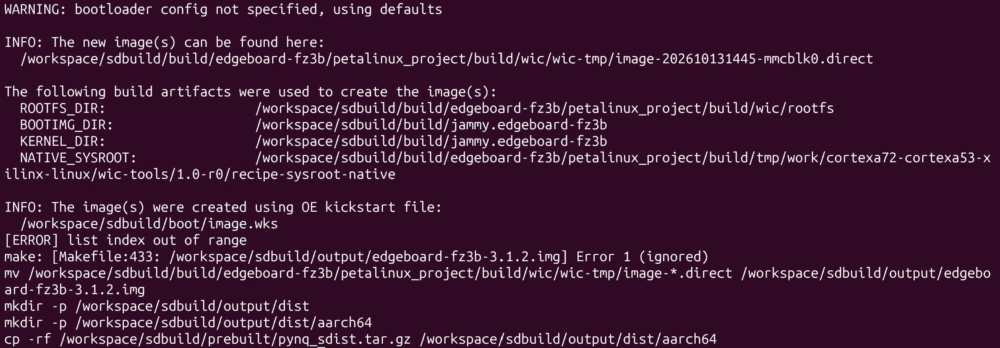

接下来验证产物，新开一个 WSL 终端：

```bash
ls -lh ~/pynq/sdbuild/output/
# 输出belike:
total 6.4G
drwxr-xr-x 3 lenovo lenovo 4.0K Oct 13 22:01 boot
drwxr-xr-x 3 lenovo lenovo 4.0K Oct 13 22:46 dist
-rw-r--r-- 1 lenovo lenovo 9.1G Oct 13 22:46 edgeboard-fz3b-3.1.2.img

file  ~/pynq/sdbuild/output/edgeboard-fz3b-*.img
```

将产物拷回 Windows，

```bash
cp ~/pynq/sdbuild/output/edgeboard-fz3b-3.1.2.img /mnt/d/
```

Windows 下下载镜像烧录工具 [balenaEtcher](https://www.etcher.com.cn/download.html)。注意，windows 下烧录时，不要理会其关于 “格式化”或“无法访问”之类的弹窗，一律叉掉即可。一定要等烧写和验证进度条走完后，再弹出，最后拔出读卡器。

TF卡插入板卡槽，上电，连网线

### 8.1 Windows 侧开启 ICS（Internet 连接共享）给板卡发 IP

按快捷键 `Win+R` 输入 `ncpa.cpl`，进入网络连接界面，其中 WLAN 侧时共享的提供方，右键 WLAN `属性`，进入 `共享`，`家庭网络连接` 选板卡连的那块以太网。

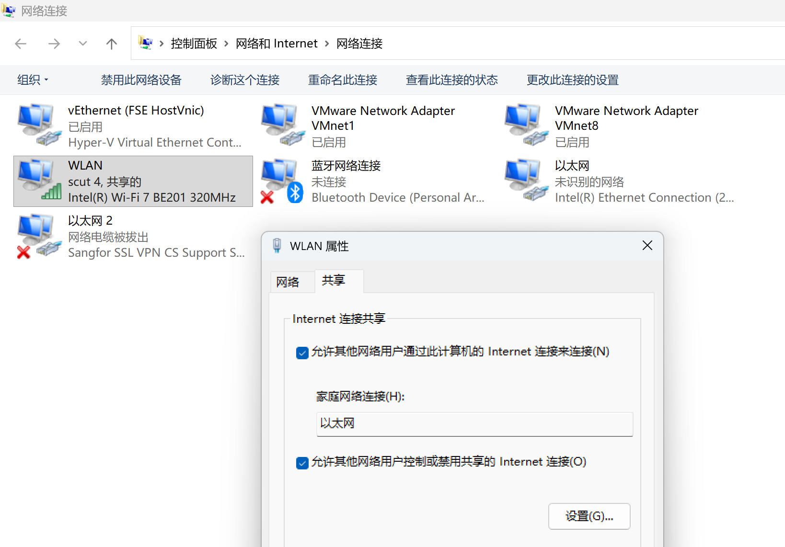

然后再powershell执行：

```powershell
arp -a | findstr 192.168.137
```

然后浏览器输入 192.168.137.x (除去 .1 和 .255 后剩下的那个)，密码为 `xilinx`
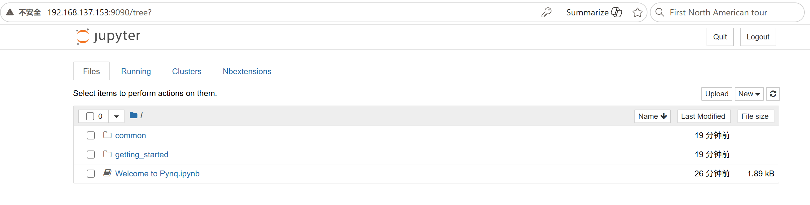
刷写 `.img` 后，刷写与首次点亮见**移植篇(二)**。与原作者预编译镜像（PYNQ v3.0.1，PetaLinux 2022.1 时代）的差异：内核与工具链代差（2022.1 → 2024.1）、PYNQ Python API 层面保持兼容，后续教程两者通用。

## 9. 验证之后

在走完**移植篇(二)**后可以着手清理 WSL 宿主机中编译过程

### 9.1 清理和压缩 WSL2 和 Docker

[社区资料1](https://zhuanlan.zhihu.com/p/2001292650641367095)

如何查看本机 .vhdx 虚拟硬盘所在？

```powershell
Get-ChildItem HKCU:\Software\Microsoft\Windows\CurrentVersion\Lxss |
  ForEach-Object { Get-ItemProperty $_.PSPath } |
  Select-Object DistributionName, BasePath
```

结果be like，vhdx 就在 BasePath\ext4.vhdx:
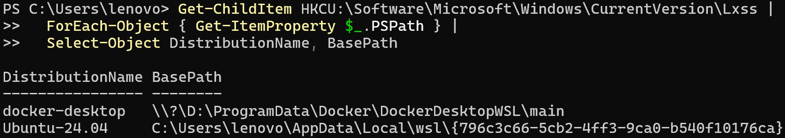

## 10. 踩坑实录（现象 → 根因 → 最小修复）

以下坑位全部来自本篇实测。通用姿势：构建命令一律加 `2>&1 | tee xxx.log` 落盘，检索用
`grep -nE "ERROR:|Error [0-9]|WARNING|skew|in the future" xxx.log`，从**第一个** Error 往前找根因——后面的多为连锁反应。Yocto 任务的全量日志在文件系统里：
`build/edgeboard-fz3b/petalinux_project/build/tmp/work/<架构>/<包名>/temp/log.do_<任务>`。

### 坑 1：Web Installer 认证报 500

**现象**：`~/.Xilinx/xinstall/*.log` 中 `rspStatusCode: 500 Internal Server Error` +
`Authentication error: An unknown exception occurred`，提示核对邮箱密码——与密码无关，是 AMD 认证服务端异常。
**出处**：AMD 认证服务端（在线环节，不涉及本地任何文件）。
**修复**：过会再重启安装进程，或者换 SFD 完整安装包。

### 坑 2：PetaLinux 安装警告 /bin/sh is not bash

**现象**：`[WARNING] No tftp server found` 可忽略（`tftpd` 包在 24.04 已不存在）；
真正的动作项是 `[WARNING] /bin/sh is not bash!`——24.04 上 `dpkg-reconfigure dash`
已失效（Noble 移除了该询问），不会弹窗。
**出处**：PetaLinux 2024.1 安装器的宿主环境自检（AMD 官方安装器要求 /bin/sh 为 bash）。
**修复**：`sudo ln -sf bash /bin/sh`，`ls -l /bin/sh` 确认 `sh -> bash` 后重跑安装器。

### 坑 3：WSL2 时钟回拨 → bitbake 编译 perl-native 失败

**现象**：bitbake 阶段大量
`Warning: File 'Makefile' has modification time 0.68 s in the future` + `Clock skew detected`，Makefile 重建循环无法收敛，perl-native do_compile 失败。
**根因**：构建中途 WSL2 内核时钟被回拨约 0.7 秒（Windows 时钟被 NTP 校正，hv_utils
瞬时传导给 WSL 内核），新写文件的时间戳全部"来自未来"。偏移量随并行任务次序每 0.01s
递增（0.66→0.70）是"回拨+并行写入"的指纹。
**出处**：失败载体是 PetaLinux 2024.1 的 poky 层 `meta/recipes-devtools/perl/perl_5.36.0.bb`
（perl-native do_compile）；触发源与三方板卡文件无关，是 WSL2/Windows 的时钟机制。
**修复**：WSL 里 `sudo apt install util-linux-extra && sudo hwclock -s`（24.04 的
hwclock 在 extra 包里），重进容器 `make` 续跑——bitbake 幂等，已完成任务走缓存。
**预防**：构建前三连（管理员 PowerShell）：`w32tm /resync /force`；`net stop w32time`；
`powercfg /change standby-timeout-ac 0`。构建后恢复：`net start w32time`；
`powercfg /change standby-timeout-ac 60`。

### 坑 4：构建树克隆 embeddedsw 被拒——两级 git 环境

**现象**：make 在 `build/jammy.edgeboard-fz3b/home/xilinx/pynq_git/` 克隆子模块时
`Failed to connect to github.com port 443`。你在容器 `~/.gitconfig` 里配的镜像
insteadOf 对它无效。
**根因**：克隆发生在 **chroot（目标 rootfs）内部**，git 读的是 rootfs 自己的
`/etc/gitconfig`——容器用户的配置对它不可见。
**出处**：PYNQ 官方 `sdbuild/Makefile` 的克隆规则（`git clone ../ $@ && git submodule
init && git submodule update`）——AMD 官方设计假设构建环境可达 GitHub，与三方板卡
文件无关。
**修复**：

```bash
git config --file ~/pynq/sdbuild/build/jammy.edgeboard-fz3b/etc/gitconfig \
  url."https://ghfast.top/https://github.com/".insteadOf "https://github.com/"
```

重跑 `make`。注意 embeddedsw 全量克隆在 qemu 模拟的 chroot 里较慢（可能 20~60 分钟），
`du -sh` 该目录判断是否在增长，别误判卡死。

### 坑 5：QEMU 源码包被墙，docker build 失败

**现象**：`wget http://download.qemu.org/qemu-5.2.0.tar.bz2` 转 HTTPS 后
`No data received` / `OpenSSL: unexpected eof`。TUNA/USTC/NJU 均无 qemu 镜像。
**出处**：PYNQ 官方 `sdbuild/Dockerfile`（wget 行硬编码 `download.qemu.org` 官方源）。
**修复**：Windows 浏览器下载官方 tar 包（可断点续传），拷进 build context，Dockerfile
把 wget 行换成 COPY（见 §7 的国内网络补丁）。

### 坑 6：串口只见三行 BL31，其他全静默

**现象**：若没有执行 6.2 的 `system-user.dtsi` 文件修复就先执行文件迁移命令，复位后串口只有 BL31 三行 NOTICE，看不到 FSBL 横幅、U-Boot 横幅和内核日志（串口调试工具为[MobaXterm](https://mobaxterm.mobatek.net/)）：

```bash
NOTICE:  BL31: Non secure code at 0x8000000
NOTICE:  BL31: v2.10.0  (release):v1.1-13187-g4f82b6134
NOTICE:  BL31: Built : 04:45:53, Mar 12 2024
```

复位多次结果完全一致——确定性失败，非偶发。两个防跑偏提示：①三行 BL31 说明 FSBL/BL31 已经跑起来了、SD 启动模式也对——板子没砖；②PC 与板卡的链路灯是亮的（PHY 协商在硬件层完成），别被"网线是通的"带偏去查物理层。

**根因**：FZ3B 的调试串口接 **PS_UART1**（[官方手册 USB_UART 接口表](https://ai.baidu.com/ai-doc/HWCE/nkq9b5ncu#%E5%8D%81%E3%80%81usb_uart%E6%8E%A5%E5%8F%A3)：MIO24/25），而 BSP 自动生成的串口配置为 FSBL/PMU/内核 = UART0、TF-A = UART1——只有 TF-A 的输出接对了线，U-Boot 与内核则在向未接线的 UART0 输出。
**出处**：分裂配置在构建生成的 `petalinux_project/project-spec/configs/config`（TF-A=UART1，其余=UART0）——由 PetaLinux 2024.1 模板自动生成；changhai0109 分发的板卡文件不含该配置文件（仓库里只有 spec/XSA/BSP dtsi/boot_leds），故非其分发物之过，而是模板默认值与 FZ3B 接线的错位。
**修复**：§6.2 的 `system-user.dtsi` 修改方案已把内核控制台锁定为 `console=ttyPS0`（接线正确的那颗）；FSBL/PMU 的输出可见性按需执行下面的串口三连 sed（只影响日志观感，不影响功能；该 sed 必须在首次 make 生成配置文件之后执行，改完重跑 make）：

```bash
sed -i \
  -e 's|^# CONFIG_SUBSYSTEM_FSBL_SERIAL_PSU_UART_1_SELECT is not set|CONFIG_SUBSYSTEM_FSBL_SERIAL_PSU_UART_1_SELECT=y|' \
  -e 's|^CONFIG_SUBSYSTEM_FSBL_SERIAL_PSU_UART_0_SELECT=y|# CONFIG_SUBSYSTEM_FSBL_SERIAL_PSU_UART_0_SELECT is not set|' \
  -e 's|^# CONFIG_SUBSYSTEM_PMUFW_SERIAL_PSU_UART_1_SELECT is not set|CONFIG_SUBSYSTEM_PMUFW_SERIAL_PSU_UART_1_SELECT=y|' \
  -e 's|^CONFIG_SUBSYSTEM_PMUFW_SERIAL_PSU_UART_0_SELECT=y|# CONFIG_SUBSYSTEM_PMUFW_SERIAL_PSU_UART_0_SELECT is not set|' \
  /workspace/sdbuild/build/edgeboard-fz3b/petalinux_project/project-spec/configs/config
```

**旁证**：原作者 `@zhutmost` [博客评论区](https://github.com/zhutmost/zhutmost-blog/discussions/10) `@f3rmata`（2025-09）在 FZ3A 上复现了同款三行 BL31 卡死，应该是同款坑。

这不是最终解决方案，执行完后重编译会进入 **坑7**

### 坑 7：首启 root 挂载 panic——root= 指向了 eMMC

**现象**：串口可见性修复（坑 6）后，内核日志出现，但
`Kernel panic - not syncing: VFS: Unable to mount root fs on unknown-block(179,10)`，`No filesystem could mount root, tried: ext4`，且无任何 `EXT4-fs` / `I/O error` 行。
**根因**：FZ3B 是 eMMC + TF 卡双存储板，枚举结果 eMMC = `mmcblk0`、TF 卡 = `mmcblk1`。模板默认 bootargs 为 `root=/dev/mmcblk0p2`——指向 **eMMC 里的出厂分区**（非 ext4），而不是 TF 卡上的 PYNQ rootfs。
**出处**：PYNQ 官方 `sdbuild/boot/meta-pynq/.../pynq_bootargs.dtsi` 的默认
`root=/dev/mmcblk0p2`（假定 root 在首个 mmc 设备上）；`@changhai0109` 分发的
`system-user.dtsi` 不涉及此文件（其原版仅含 sdhci1 修复）。
**修复**：§6.3 第二步的 `pynq_bootargs.dtsi` 修改（`root=/dev/mmcblk1p2`）。若已跑完
构建，改完重跑 make 重编 dtb/image.ub，只需把新的 `image.ub` 拷到 TF 卡 FAT 分区
覆盖，无需整卡重刷。

## 11. 参考文献与致谢

**参考文献**：

1. Haozhe Zhu（@zhutmost），《EdgeBoard 的 PYNQ 移植》，zhutmost.com，
   https://zhutmost.com/post/pynq-compile （2021）；
2. Haozhe Zhu（@zhutmost），《PYNQ v3.1 编译的 Debug 之旅》，zhutmost.com，
   https://zhutmost.com/post/pynq-compile-2 （2025，2026 更新）；
3. Haozhe Zhu（@zhutmost）, @changhai0109, zhutmost/edgeboard 仓库（板卡文件与流程）：https://github.com/zhutmost/edgeboard
   ——文档以 CC-BY 4.0、代码以 MIT（Copyright (c) 2019 Haozhe Zhu）发布；
4. Xilinx PYNQ 仓库 sdbuild 文档（本文 docker/make 命令与版本结论的出处）：
   https://github.com/Xilinx/PYNQ/blob/master/sdbuild/README.md ；
5. AMD UG973（2024.1 Release Notes, Installation and Licensing）。

**版权与致谢**：本系列的移植工作由
[Haozhe Zhu（@zhutmost）](https://github.com/zhutmost)开创，FZ3B 编译流程与预编译镜像由 [Changhai（@changhai0109）](https://github.com/changhai0109)贡献。本文是对上述文档与博客的**改编整理**，并补充博主实测内容；原作者未参与本文写作。本文以[CC-BY 4.0](https://creativecommons.org/licenses/by/4.0/) 发布，转载请保留本节署名。

> 声明：Baidu EdgeBoard 为百度推出的硬件产品；原作者仓库及本文均为个人社区行为，
> 与百度/ALINX/MYIR等官方教程无关。
